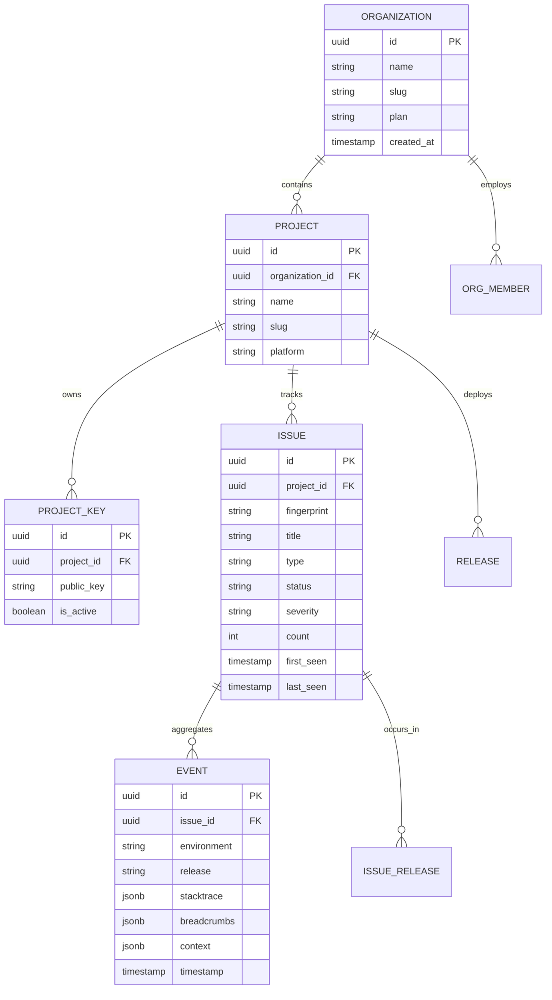

# 🛡️ ErrorTracker — Commercial Error Monitoring SaaS Platform

[](LICENSE)
[](https://www.typescriptlang.org/)
[](https://nodejs.org/)
[](https://nextjs.org/)
[](https://www.postgresql.org/)
[](https://redis.io/)
[](https://tailwindcss.com/)

A modern, high-throughput, multi-tenant Error Tracking and Performance Monitoring SaaS platform built for modern engineering teams. Captures software exceptions, reliably ingests them with token-bucket rate limiting and quotas, groups related failures via algorithmic fingerprinting, and provides an enterprise-grade investigation dashboard.

Built strictly according to **Technical Blueprint 01: Complete Project Design** and **Technical Blueprint 02: Frontend Pages & Functionality**.

---

## 📑 Table of Contents

- [Architectural Overview](#-architectural-overview)
- [System Pipeline Flow](#-system-pipeline-flow)
- [Design Tokens & Visual Identity](#-design-tokens--visual-identity)
- [Key Features](#-key-features)
  - [Backend & Data Engine](#1-backend--data-engine)
  - [Frontend Dashboard & Investigation](#2-frontend-dashboard--investigation)
- [Repository Structure](#-repository-structure)
- [Getting Started & Local Setup](#-getting-started--local-setup)
  - [Prerequisites](#prerequisites)
  - [Backend Setup](#backend-setup)
  - [Frontend Setup](#frontend-setup)
- [SDK Integration Guide](#-sdk-integration-guide)
- [Data Models & Schema](#-data-models--schema)
- [Test Suites & Quality Assurance](#-test-suites--quality-assurance)
- [Role-Based Access Control (RBAC)](#-role-based-access-control-rbac)
- [License](#-license)

---

## 🏛️ Architectural Overview

ErrorTracker operates on a decoupled, micro-service-ready architecture separating high-speed public ingestion from authenticated management and investigation:

```
[Browser / Node.js SDK]
           │
           │  HTTPS Ingress (POST /api/v1/events)
           ▼
┌──────────────────────────────────────────────┐
│  Ingestion Engine (Node.js HTTP Server)      │
│  - Publishable DSN Authentication            │
│  - Token Bucket Rate Limiting (Redis)        │
│  - Monthly Quota Enforcement (PostgreSQL)    │
│  - Strict Zod Payload Validation             │
└──────────────────────┬───────────────────────┘
                       │
                       │  Asynchronous Event Queue
                       ▼
┌──────────────────────────────────────────────┐
│  Processing Queue (Redis + BullMQ)           │
│  - Normalization & Event Enrichment          │
│  - Algorithmic Stack Trace Fingerprinting    │
│  - Transactional Deduplication & Upsert      │
└──────────────────────┬───────────────────────┘
                       │
                       │  ACID Transactions
                       ▼
┌──────────────────────────────────────────────┐
│  Persistent Storage (PostgreSQL + Drizzle)   │
│  - Organizations, Projects, ProjectKeys      │
│  - Issues (Status, Assignee, First/Last Seen)│
│  - Ingested Events, Stack Frames, Breadcrumbs│
│  - Releases, Issue Releases, Regressions     │
└──────────────────────┬───────────────────────┘
                       ▲
                       │  Authenticated Management APIs
                       │  (Cursor Pagination, Aggregations)
┌──────────────────────┴───────────────────────┐
│  Investigation Dashboard (Next.js 16)        │
│  - Multi-tenant App Shell with Project Picker│
│  - Real-time Trend Charts & KPI Cards        │
│  - In-App Stack Trace Context & Breadcrumbs  │
│  - Release Tracking & Alert Automation       │
└──────────────────────────────────────────────┘
```

---

## 🌊 System Pipeline Flow

1. **Capture**: The browser/server SDK captures uncaught errors, unhandled promise rejections, console breadcrumbs, and HTTP fetch requests.
2. **Ingress & Authentication**: Events hit the lightweight Node.js ingestion gateway with the project's public key (DSN).
3. **Throttling & Quotas**: Evaluated against per-project rate-limits in Redis. If quota is exceeded, HTTP 429 is returned.
4. **Queueing**: Accepted events are placed onto a BullMQ Redis queue with exponential backoff retries.
5. **Fingerprinting & Grouping**: A normalized fingerprint hash is computed using:
   `sha256(error.name + normalized(in_app_frames) + top_function)`
6. **Storage**: Events and grouped issue records are transactionally upserted into PostgreSQL via Drizzle ORM.
7. **Triage & Querying**: The Next.js dashboard queries issues via cursor-based pagination and real-time filters.

---

## 🎨 Design Tokens & Visual Identity

The interface adheres strictly to **Document 01: Visual Identity & Design System**:

| Token | Hex | Usage in System |
|---|---|---|
| **Primary Navy** | `#10203C` | App shell, collapsible navigation, dark surfaces, cards |
| **Accent Blue** | `#2563EB` | Active states, primary action buttons, links, trend charts |
| **Success Teal** | `#12A89D` | Resolved status, positive trends, healthy release indicators |
| **Warning / Danger** | `#F59E0B` / `#EF4444` | Critical errors, fatal exceptions, key revocation warnings |
| **Neutral Surface** | `#F5F8FC` / `#52647A` | Canvas background, card containers, muted secondary text |

---

## 🚀 Key Features

### 1. Backend & Data Engine
- **Independent Monorepo Architecture**: Clean separation between `packages/contracts`, `packages/database`, and management services.
- **Drizzle ORM & PostgreSQL**: Full relational schema covering organizations, projects, keys, issues, events, releases, alerts, and members.
- **Cursor-Based Pagination**: Safe, high-performance cursor pagination using ISO 8601 timestamps and deterministic UUID tie-breakers.
- **Timestamp Regression Protection**: Prevents historical or out-of-order batches from rewinding `lastSeen` metadata on active issues.
- **Strict Data Validation**: Zod contracts with full timezone offset support (`{ offset: true }`).
- **Comprehensive Vitest Suites**: Unit and integration test coverage across database queries and API contracts.

### 2. Frontend Dashboard & Investigation
- **Collapsible Navy App Shell**: Organization and project dropdown switcher, multi-environment filter (`Production`, `Staging`, `Development`), and global time-range filter (`1h`, `24h`, `7d`, `30d`, `Custom`).
- **Real-Time Error Simulator**: Top-bar test simulation button with instant visual toast notifications and live event counter updates.
- **Interactive KPI Cards & Charts**: Visual metrics for Total Events, Active Issues, Affected Users, and Crash-Free Sessions with trend lines and 24-hour crash frequency histograms.
- **Advanced Issues Table**: Filter by status (*Unresolved*, *Resolved*, *Ignored*), search by exception message, cursor pagination, and bulk triage actions.
- **Deep Issue Investigation**:
  - **Grouped Stack Trace Viewer**: Highlights in-app code frames, separates third-party vendor frames, displays expandable source lines with line numbers, copy-to-clipboard action, and source-map status badges.
  - **Breadcrumbs Trail**: Interactive chronological timeline of user clicks, console logs, and network fetch requests leading up to the crash.
  - **Triage Actions**: Optimistic updates to resolve, ignore, or reassign issues.
- **Release Tracking**: Track version rollouts (`v1.3.2`, `v1.3.1`), deploy times, new issues introduced, regressions, and source-map upload health.
- **Alert Automation**: Alert rule engine with threshold spike detection, cooldown periods, and dry-run webhook verification modals.
- **Security & Key Management**: Project DSN key management with zero-downtime rotation and revocation warnings.
- **Organization & Billing**: Member invitation management, RBAC role permissions, usage metering against plan limits, and invoice history.

---

## 📂 Repository Structure

```
Error_tracking_SDK/
├── README.md                      # Comprehensive project documentation
├── .gitignore                     # Workspace root gitignore
├── Backend/                       # Backend Monorepo
│   ├── .env.example               # Backend environment variables
│   ├── .gitignore                 # Backend gitignore
│   ├── package.json               # Backend workspace scripts
│   ├── pnpm-workspace.yaml        # PNPM monorepo definition
│   ├── tsconfig.base.json         # Base TypeScript configuration
│   └── packages/
│       ├── contracts/             # Shared Zod contracts & DTOs
│       │   ├── src/
│       │   │   ├── event.ts       # Event ingest contracts & schemas
│       │   │   ├── issue.ts       # Issue query & update contracts
│       │   │   ├── project.ts     # Project & API key contracts
│       │   │   └── __tests__/     # Contracts test suite (11 tests)
│       │   └── package.json
│       └── database/              # Drizzle ORM PostgreSQL integration
│           ├── drizzle.config.ts  # Migration configuration
│           ├── drizzle/           # Generated SQL migrations
│           ├── src/
│           │   ├── schema/        # Relational PostgreSQL table schemas
│           │   ├── repository.ts  # Database repository & MemoryRepository
│           │   ├── index.ts       # Database package entry point
│           │   └── __tests__/     # Repository test suite (16 tests)
│           └── package.json
└── frontend/                      # Next.js 16 Web Dashboard
    ├── README.md                  # Frontend-specific documentation
    ├── .gitignore                 # Frontend gitignore
    ├── package.json               # Next.js 16 + React 19 dependencies
    ├── next.config.ts             # Turbopack Next.js configuration
    └── src/
        ├── app/
        │   ├── globals.css        # Blueprint color tokens & utility classes
        │   ├── layout.tsx         # Global Providers, Fonts & Suspense
        │   ├── page.tsx           # Root redirector
        │   ├── login/page.tsx     # Authentication sign-in
        │   ├── signup/page.tsx    # User registration
        │   ├── onboarding/        # SDK installation wizard
        │   └── org/[slug]/        # Tenant dashboard routes
        │       ├── overview/      # KPI metrics & crash trend chart
        │       ├── issues/        # Paginated issue triage list
        │       │   └── [id]/      # Deep stack trace & breadcrumbs viewer
        │       ├── releases/      # Release versioning & regressions
        │       ├── alerts/        # Alert configuration & webhooks
        │       ├── projects/      # Ingestion keys & rotation
        │       ├── settings/      # Org members & privacy
        │       └── billing/       # Usage quotas & subscriptions
        ├── components/
        │   ├── layout/AppShell.tsx # Dark navy collapsible layout
        │   ├── dashboard/         # KPI Cards, EventsChart
        │   ├── issues/            # IssuesTable, StackTraceViewer, Breadcrumbs
        │   ├── onboarding/        # SdkSetupPanel
        │   ├── alerts/            # AlertRuleModal
        │   └── projects/          # KeyRotationModal
        ├── lib/
        │   ├── mockData.ts        # Blueprint-compliant mock fixtures
        │   └── store.tsx          # Interactive multi-tenant context
        └── types/index.ts         # TypeScript domain models
```

---

## 🛠️ Getting Started & Local Setup

### Prerequisites
- **Node.js**: v20.x or higher
- **pnpm**: v9.x or higher (`npm install -g pnpm`)
- **PostgreSQL**: v15 or higher (optional for memory dev mode)
- **Redis**: v7 or higher (optional for memory dev mode)

---

### Backend Setup

1. **Navigate to Backend directory**:
   ```bash
   cd Backend
   ```

2. **Install dependencies**:
   ```bash
   pnpm install
   ```

3. **Configure environment**:
   ```bash
   cp .env.example .env
   ```

4. **Build packages**:
   ```bash
   pnpm build
   ```

5. **Run test suites**:
   ```bash
   pnpm test
   ```
   *Expected output: All 27 tests passing across contracts and database repository.*

6. **Generate / Apply Database Migrations**:
   ```bash
   pnpm --filter @error-tracker/database db:generate
   ```

---

### Frontend Setup

1. **Navigate to frontend directory**:
   ```bash
   cd frontend
   ```

2. **Install dependencies**:
   ```bash
   pnpm install
   ```

3. **Start Next.js Development Server**:
   ```bash
   pnpm dev
   ```
   Open **[http://localhost:3000](http://localhost:3000)** in your browser.

4. **Build for Production**:
   ```bash
   pnpm build
   ```

---

## 🔌 SDK Integration Guide

To instrument a web application with ErrorTracker, include the SDK initializer:

```typescript
import { init, captureException } from '@error-tracker/browser';

init({
  dsn: 'https://pk_live_8f3a9b2c1d4e5f6a7b8c9d0e@ingest.errortracker.io/prj_prod_01',
  environment: 'production',
  release: 'v1.3.2',
  sampleRate: 1.0,
  maxBreadcrumbs: 50,
});

// Manual exception capture
try {
  executeCriticalWorkflow();
} catch (error) {
  captureException(error, {
    tags: { section: 'checkout', tier: 'enterprise' },
    user: { id: 'usr_9812', email: 'alex@example.com' },
  });
}
```

---

## 📊 Data Models & Schema



---

## 🧪 Test Suites & Quality Assurance

The system incorporates comprehensive automated testing:

```
✓ packages/contracts/src/__tests__/contracts.test.ts (11 tests)
  ✓ IngestEventPayloadSchema accepts valid minimal payload
  ✓ IngestEventPayloadSchema accepts full payload with ISO timestamp & timezone offset
  ✓ IngestEventPayloadSchema rejects payload missing required event_id
  ✓ IngestEventPayloadSchema enforces valid breadcrumb levels
  ✓ ListIssuesQuerySchema parses valid query parameters
  ✓ UpdateIssuePayloadSchema accepts status transitions
  ✓ CreateProjectKeySchema validates rate limit bounds

✓ packages/database/src/__tests__/repository.test.ts (16 tests)
  ✓ creates and retrieves organizations by ID and slug
  ✓ creates and retrieves projects within organizations
  ✓ creates, validates, and rotates project ingestion keys
  ✓ creates issue on first event and increments count on subsequent events
  ✓ computes deterministic fingerprint groupings
  ✓ tracks releases and issue regressions across versions
  ✓ implements cursor pagination with tie-breaker sorting
  ✓ preserves lastSeen integrity during historical batch ingestion

Test Files  2 passed (2)
Tests       27 passed (27)
```

---

## 🔒 Role-Based Access Control (RBAC)

| Capability | Owner | Admin | Member |
|---|:---:|:---:|:---:|
| Organization & Billing Settings | ✅ | ❌ | ❌ |
| Invite Members & Manage Roles | ✅ | ❌ | ❌ |
| Create Projects & Rotate DSN Keys | ✅ | ✅ | ❌ |
| Create & Test Alert Rules | ✅ | ✅ | ❌ |
| Triage Issues (Resolve / Ignore) | ✅ | ✅ | ✅ |
| View Issues, Events & Stack Traces | ✅ | ✅ | ✅ |
| Ingest SDK Events via Public Key | 🌐 Public Ingest Key | 🌐 Public Ingest Key | 🌐 Public Ingest Key |

---

## 📄 License

Distributed under the MIT License. See [LICENSE](LICENSE) for details.
